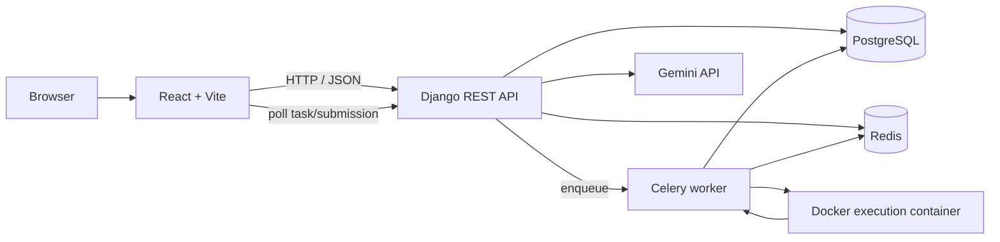

# CodeAlly

**A web-based coding practice and online judging platform.**

CodeAlly combines a problem library, browser-based code editor, custom-input execution, asynchronous solution submissions, verdict tracking, user profiles, a leaderboard, and AI-assisted code feedback.

> This README documents the implementation found in this repository. It distinguishes the active judge path from the separate warm-container experiment; it does not imply that every UI language option is fully supported end-to-end.

## Features

- Browse coding problems and inspect descriptions, examples, difficulty, and tags.
- Write code in an in-browser Monaco editor.
- Run code with custom input and inspect output.
- Submit solutions for asynchronous evaluation against hidden test cases.
- Track submission verdicts, runtime, memory, and error details.
- Register and log in using email and password.
- View user profiles and a leaderboard.
- Request password-reset links.
- Create/delete problems through admin-facing functionality.
- Request AI code feedback through the Gemini integration.

## Technology stack

| Layer | Technologies |
|---|---|
| Frontend | React 19, Vite, React Router, Axios, Monaco Editor, Tailwind CSS |
| Backend | Python, Django 6, Django REST Framework |
| Authentication | Custom email-based Django user, Simple JWT |
| Database | PostgreSQL |
| Background jobs | Celery |
| Queue and task results | Redis |
| Code execution | Docker, GCC 14 runner image |
| AI feedback | Google Generative AI SDK |

## Architecture



**Submit flow:** the API creates a persistent `Submission` record, queues a Celery task, and returns a submission ID. The worker evaluates hidden test cases and updates the record. The frontend polls the submission status endpoint.

**Run flow:** the API queues a transient execution task. Celery stores its result in Redis; the client can poll the Run status endpoint using the task ID. Run results are not stored as persistent `Submission` records.

## Repository layout

```text
CodeAlly/
├── backend/
│   ├── backend/          # Django settings, root URLs, Celery app
│   ├── users/             # Registration, login, profiles, password reset
│   ├── problems/          # Problem model and APIs
│   ├── submissions/      # Submission model and status/history APIs
│   ├── leaderboard/      # Leaderboard API
│   ├── gemini_ai/        # AI feedback API
│   ├── judge/             # Judge endpoints, tasks, executors and services
│   ├── cpp_runner/       # Docker build context for C++ runner image
│   └── requirements.txt
└── frontend/
    ├── src/apis/          # Axios API functions
    ├── src/components/    # Shared UI and compiler components
    ├── src/context/       # Authentication context
    └── src/pages/         # Application pages
```

## Getting started

### Prerequisites

Install Python (the project has been developed with Python 3.13), Node.js/npm, PostgreSQL, Redis, and Docker Engine. The backend/Celery worker must be able to access the Docker daemon.

### Clone

```bash
git clone https://github.com/shreyash18g/CodeAlly.git
cd CodeAlly
```

### Backend setup

```bash
cd backend
python3 -m venv venv
source venv/bin/activate
pip install -r requirements.txt
```

Create `backend/.env` (never commit it):

```env
DJANGO_SECRET_KEY=generate_a_private_random_secret
DEBUG=True
ALLOWED_HOSTS=localhost,127.0.0.1

DB_NAME=codejudge
DB_USER=codejudge_user
DB_PASSWORD=your_local_postgres_password
DB_HOST=localhost
DB_PORT=5432
```

Create the PostgreSQL database/user as needed, then:

```bash
python manage.py migrate
python manage.py createsuperuser
python manage.py check
```

Build the runner image from the repository root:

```bash
docker build -t codejudge-cpp:latest ./backend/cpp_runner
```

The Dockerfile is based on `gcc:14`.

### Frontend setup

In another terminal:

```bash
cd CodeAlly/frontend
npm install
```

Create `frontend/.env`:

```env
VITE_BACKEND_URL=http://127.0.0.1:8000
```

This is the backend origin; the Axios client appends `/api/...` paths. Never put private secrets in `VITE_` variables because they are exposed to browser code.

## Run locally

Start PostgreSQL, Redis, and Docker first.

**Django API:**

```bash
cd CodeAlly/backend
source venv/bin/activate
python manage.py runserver 0.0.0.0:8000
```

**Celery worker, in a separate terminal:**

```bash
cd CodeAlly/backend
source venv/bin/activate
celery -A backend worker --loglevel=info -Q judge,celery
```

Celery is configured to use `redis://localhost:6379/0` as broker and result backend. The `judge.tasks.process_submission` task is routed to the `judge` queue.

**React frontend, in another terminal:**

```bash
cd CodeAlly/frontend
npm run dev
```

Open the URL printed by Vite (normally `http://localhost:5173`).

## Configuration reference

| Variable | Purpose | Local example |
|---|---|---|
| `DJANGO_SECRET_KEY` | Django signing key | Unique private value |
| `DEBUG` | Debug mode | `True` locally; `False` in production |
| `ALLOWED_HOSTS` | Comma-separated hostnames | `localhost,127.0.0.1` |
| `DB_NAME` | PostgreSQL database | `codejudge` |
| `DB_USER` | PostgreSQL role | `codejudge_user` |
| `DB_PASSWORD` | PostgreSQL password | Private value |
| `DB_HOST` | Database host | `localhost` |
| `DB_PORT` | Database port | `5432` |
| `VITE_BACKEND_URL` | Frontend's backend origin | `http://127.0.0.1:8000` |

Configure frontend URL, email delivery, and provider credentials for your own environment as required by the settings. The checked-in development configuration uses Django's console email backend; configure SMTP or another real email provider to deliver password-reset messages.

## API overview

| Method | Endpoint | Purpose |
|---|---|---|
| `POST` | `/api/auth/register/` | Register |
| `POST` | `/api/auth/login/` | Obtain JWT access/refresh tokens |
| `GET` | `/api/auth/profile/` | Current user's profile |
| `GET` | `/api/auth/profile/{user_id}/` | Another user's profile |
| `POST` | `/api/auth/forgot-password/` | Request reset link |
| `POST` | `/api/auth/reset-password/` | Reset password |
| `GET` | `/api/problems/` | List problems |
| `GET` | `/api/problems/{problemNumber}/` | Get a problem |
| `POST` | `/api/problems/admin/create/` | Create a problem |
| `DELETE` | `/api/problems/admin/delete/{problemNumber}/` | Delete a problem |
| `POST` | `/api/judge/submit/` | Queue submission |
| `POST` | `/api/judge/run/` | Queue code run |
| `GET` | `/api/judge/run-status/{task_id}/` | Poll Run task |
| `GET` | `/api/submissions/{id}/` | Submission status |
| `GET` | `/api/submissions/history/` | Submission history |
| `GET` | `/api/submissions/details/{id}/` | Submission details |
| `GET` | `/api/leaderboard/` | Leaderboard |
| `POST` | `/api/gemini/feedback/` | AI feedback |

Authenticated API calls use `Authorization: Bearer <access_token>`. Consult the relevant Django view/serializer for exact payloads and permissions.

## Judge execution and verdicts

The active submission task calls `judge.services.judge_problem`. It creates a temporary workspace, compiles the submitted C++ program, runs it against each hidden test case, normalizes and compares output, and removes the workspace in a `finally` block. The submission model includes `QUEUED`, `RUNNING`, `ACCEPTED`, `WRONG_ANSWER`, `COMPILE_ERROR`, `RUNTIME_ERROR`, `INTERNAL_ERROR`, and `TIME_LIMIT_EXCEEDED`.

### Warm-container experiment

`judge/executors/warm_runner.py` and `judge/services_warm.py` implement a separate approach: one long-lived Docker container per submission, reused for compilation and its test cases. **This is not wired into the active `process_submission` task in the checked-in code**; the task imports and calls the standard `judge.services.judge_problem` function. Warm reuse has a different isolation trade-off because test cases share a container. Treat it as experimental until cleanup, resource accounting, and adversarial-code isolation are validated.

### Language support caveat

Some frontend editor components offer C++, Python, and JavaScript selections. The active backend Run task and standard submission service shown in this repository use the C++ compiler/runner path. Verify complete backend executor integration before claiming multi-language judging support.

## Performance experiments

The backend contains scripts for cold/warm container overhead, submission bursts, Docker cleanup monitoring, progressive spike testing, and execution diagnostics. These are controlled experiments, not capacity guarantees. Run only against an environment you own, start with low concurrency, and verify queue routing, rate limits, and worker configuration.

## Security and deployment

Before public deployment:

- Set `DEBUG=False`; configure restrictive `ALLOWED_HOSTS`.
- Restrict CORS to trusted frontend origins.
- Store Django, database, email, and AI-provider secrets outside source control.
- Configure real email delivery and HTTPS.
- Review API authorization, rate limits, and admin operations.
- Harden Docker execution and the host. Containerization alone is not a complete security boundary for arbitrary untrusted code.
- Keep `.env`, virtual environments, `node_modules`, generated CSVs, and local artifacts out of Git.

## Development checks

```bash
# Backend
python manage.py check
python manage.py test

# Frontend
npm run lint
npm run build
```

## License

No license is included in the inspected repository. Add a `LICENSE` file before describing the project as open source.
