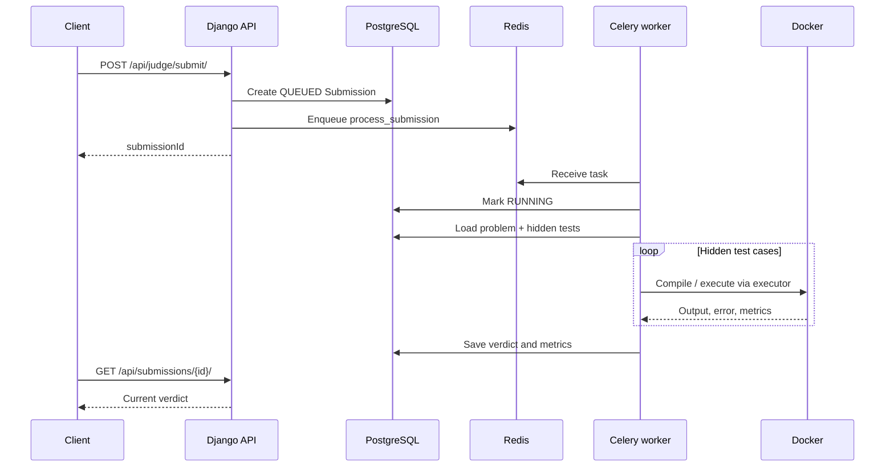

# CodeAlly Backend

Django REST API and asynchronous code-judging service for CodeAlly. See the [root README](../README.md) for the product overview and [frontend README](../frontend/README.md) for client setup.

## Responsibilities

- Email-based registration/login, JWT authentication, profiles, and password reset.
- Problem data and hidden test cases.
- Persistent submission records and verdict tracking.
- Asynchronous Run and Submit tasks through Celery/Redis.
- Docker-based C++ compilation and execution.
- Leaderboard and Gemini feedback APIs.

## Stack

Python 3.13 (development environment), Django 6.0.6, Django REST Framework, PostgreSQL, Celery 5.6, Redis, Simple JWT, Docker SDK, `python-dotenv`, and Google Generative AI SDK. Exact pinned dependencies are in `requirements.txt`.

## Layout

```text
backend/
├── backend/       # Django settings, root URLs, Celery application
├── users/         # Custom user model and authentication endpoints
├── problems/      # Problem model, serializers and APIs
├── submissions/   # Submission model, history/status APIs
├── leaderboard/   # Leaderboard endpoint
├── gemini_ai/     # AI feedback endpoint
├── judge/
│   ├── executors/ # Compiler, runner and warm-runner code
│   ├── tasks.py   # Celery Run and Submit tasks
│   ├── services.py
│   └── services_warm.py
├── cpp_runner/    # C++ Docker image build context
├── manage.py
└── requirements.txt
```

## Prerequisites

- Python 3.13 recommended to match the development environment.
- PostgreSQL and Redis.
- Docker Engine and backend-worker access to the Docker daemon.
- GCC 14 runner image.

## Install

From repository root:

```bash
cd backend
python3 -m venv venv
source venv/bin/activate
pip install -r requirements.txt
```

Create `backend/.env`:

```env
DJANGO_SECRET_KEY=generate_a_private_random_secret
DEBUG=True
ALLOWED_HOSTS=localhost,127.0.0.1

DB_NAME=codejudge
DB_USER=codejudge_user
DB_PASSWORD=your_local_postgres_password
DB_HOST=localhost
DB_PORT=5432
```

Do not commit `.env`. Create the PostgreSQL database and role, then run:

```bash
python manage.py migrate
python manage.py createsuperuser
python manage.py check
```

Build the runner image from repository root:

```bash
docker build -t codejudge-cpp:latest ./backend/cpp_runner
```

The runner Dockerfile uses `gcc:14` and `/workspace` as its working directory.

## Start services

Start PostgreSQL, Redis, and Docker daemon.

**Django:**

```bash
cd backend
source venv/bin/activate
python manage.py runserver 0.0.0.0:8000
```

**Celery worker (separate terminal):**

```bash
cd backend
source venv/bin/activate
celery -A backend worker --loglevel=info -Q judge,celery
```

The Celery app configures Redis DB 0 as both broker and result backend. `judge.tasks.process_submission` is routed to the `judge` queue.

## Environment variables

| Variable | Purpose | Development value |
|---|---|---|
| `DJANGO_SECRET_KEY` | Django signing key | Unique private value |
| `DEBUG` | Debug mode | `True` |
| `ALLOWED_HOSTS` | Allowed hostnames, comma-separated | `localhost,127.0.0.1` |
| `DB_NAME` | PostgreSQL database | `codejudge` |
| `DB_USER` | PostgreSQL role | `codejudge_user` |
| `DB_PASSWORD` | PostgreSQL password | Private value |
| `DB_HOST` | Database hostname | `localhost` |
| `DB_PORT` | Database port | `5432` |

Configure frontend URL, email transport, and provider credentials for the target environment. The development email backend currently writes messages to the console; configure SMTP or another email provider for actual password-reset delivery.

## API routes

All route groups are mounted in `backend/urls.py`.

### Authentication — `/api/auth/`

| Method | Path | Purpose |
|---|---|---|
| `POST` | `/register/` | Register user |
| `POST` | `/login/` | Return JWT access and refresh tokens |
| `GET` | `/test-auth/` | Verify authenticated identity |
| `GET` | `/profile/` | Current user profile |
| `GET` | `/profile/{user_id}/` | Another user's profile |
| `POST` | `/forgot-password/` | Generate reset link |
| `POST` | `/reset-password/` | Validate token and change password |

The custom user model uses email as `USERNAME_FIELD`. Protected calls use `Authorization: Bearer <access_token>`. The current password validator requires at least six characters, one uppercase letter, and one digit. Reset tokens are random, stored as SHA-256 hashes, and expire after 15 minutes.

### Problems — `/api/problems/`

| Method | Path | Purpose |
|---|---|---|
| `GET` | `/` | List problems |
| `GET` | `/{problemNumber}/` | Retrieve problem |
| `GET` | `/admin/` | Admin status |
| `POST` | `/admin/create/` | Create problem |
| `DELETE` | `/admin/delete/{problemNumber}/` | Delete problem |

Problem records include problem number, title, description, sample input/output, hidden test cases, difficulty, and tags.

### Judge — `/api/judge/`

| Method | Path | Purpose |
|---|---|---|
| `POST` | `/submit/` | Queue persistent submission |
| `POST` | `/run/` | Queue transient code run |
| `GET` | `/run-status/{task_id}/` | Poll Run task |
| `POST` | `/run/authenticated/` | Authenticated Run variant if exposed by current URL config |

Inspect `judge/urls.py` and `judge/views.py` for exact active routes and request/response schemas.

### Submissions — `/api/submissions/`

| Method | Path | Purpose |
|---|---|---|
| `GET` | `/{id}/` | Submission status |
| `GET` | `/history/` | Submission history |
| `GET` | `/details/{id}/` | Submission details |
| `...` | `/verdict/` | Verdict update route |

Other route groups: `GET /api/leaderboard/` and `POST /api/gemini/feedback/`.

## Submission lifecycle



When a submission is accepted, the task adds its problem number to the user's `solvedProblems` list if it is not already present.

## Judge implementation

### Standard path

`judge.tasks.process_submission` calls `judge.services.judge_problem`. The service creates a temporary workspace, compiles the C++ source, writes each test's input, executes the binary, normalizes and compares output, and cleans up the workspace in a `finally` block. It stops on the first compile error, runtime error, time limit, or wrong answer. The submission stores verdict, runtime, memory, and error information.

Verdicts include `QUEUED`, `RUNNING`, `ACCEPTED`, `WRONG_ANSWER`, `COMPILE_ERROR`, `RUNTIME_ERROR`, `INTERNAL_ERROR`, and `TIME_LIMIT_EXCEEDED`.

### Run versus Submit

- Run queues a temporary execution task. Its result is held in the Celery result backend (Redis) and retrieved using the task ID.
- Submit creates a durable PostgreSQL `Submission` record and checks hidden test cases.

### Language support

The frontend contains C++, Python, and JavaScript selections in parts of the UI. The active Run task imports the C++ compiler and runner, and the standard submission service is C++-oriented. Do not claim all three languages are supported end-to-end until their backend executor paths are implemented and tested.

## Warm-container experiment

`judge/executors/warm_runner.py` and `judge/services_warm.py` create one long-lived container per submission, compile inside it, and execute test cases through `container.exec_run`.

**This implementation is not currently wired into `process_submission`.** The active task imports and calls `judge.services.judge_problem`, not `judge_problem_warm`.

Warm reuse can reduce repeated container startup overhead, but test cases share a container. Cleanup is best-effort and the isolation/resource-accounting trade-offs require careful validation. Treat this path as experimental.

## Testing, benchmarking, and performance evaluation

The backend repository includes a small suite of **manual performance and infrastructure experiments**. These are intended to evaluate the judge execution model and observe how the API and worker behave under concurrent load. They are not Django unit tests and are not automatically run by `manage.py test` or during application startup.

The experiments were designed around several questions:

1. How much overhead does creating Docker containers add to compilation and testcase execution?
2. Can a single container be reused across testcases to reduce repeated startup cost?
3. How does the asynchronous Submit pipeline behave when many submissions arrive together?
4. Are judge containers cleaned up after execution?
5. How does the service behave as Submit and Run traffic increases in progressive bursts?

### Test-suite overview

| Script | Experiment | Main measurements / observations |
|---|---|---|
| `test_a_container_overhead.py` | Cold-container overhead | Preparation, compilation, execution timings and summary statistics for repeated submissions/testcases. |
| `test_a_warm_container_overhead.py` | Warm-container overhead | Container startup, compilation, repeated execution, teardown and total submission time when a container is reused. |
| `test_c_submission_burst.py` | Concurrent Submit burst | API acceptance/enqueue throughput, time until submissions reach final verdicts, Redis/Celery queue activity and Docker container counts. |
| `test_d_leak_monitor.py` | Docker cleanup / leak observation | Periodic running-container count, total matching-container count and host-available memory; writes samples to CSV. |
| `test_e_spike.py` | Progressive Submit + Run spike test | Runs increasing request levels, records Submit acceptance and Run task outcomes/latencies, then observes Submit drain time and infrastructure peaks. |
| `diagnose_exec.py`, `diagnose_exec2.py` | Execution diagnostics | Small diagnostic utilities for investigating the local C++ execution/container path. |

> **Scope note:** The uploaded project snapshot contains the scripts listed above. The numbering has gaps (for example, there is no `test_b_run_code_load.py` in that snapshot); this README documents the files that are actually present rather than implying that a missing test is included.

### 1. Cold-container versus warm-container benchmark

The two `test_a_...` scripts compare two execution strategies using a simple C++ program that reads two integers and prints their sum.

**Cold-container benchmark — `test_a_container_overhead.py`**

- Repeats a submission workflow a configurable number of times (30 iterations by default in the script).
- Prepares a temporary submission workspace and measures compilation time.
- Writes testcase input and measures binary execution time.
- Removes the temporary workspace after each iteration.
- Reports timing statistics such as mean, median, standard deviation, minimum and maximum, and provides estimates for workloads with different testcase counts.
- Models the current cold path, where compilation and testcase execution invoke the executor's Docker flow separately. Confirm the executor implementation when changing this benchmark; container lifecycle behavior is implementation-dependent.

**Warm-container benchmark — `test_a_warm_container_overhead.py`**

- Starts one container for a submission.
- Compiles the program inside that container.
- Reuses the same container to execute multiple testcase inputs.
- Stops/removes the container and cleans the temporary workspace.
- Measures startup, compilation, per-testcase execution, teardown and total submission duration.

The purpose of the comparison is to isolate the cost of repeatedly starting containers and assess whether reuse reduces per-submission overhead. The benchmark does **not** by itself establish that warm reuse is safe for production. Reusing a container means testcases share a container environment, so process cleanup, filesystem state, resource limits, timeouts and isolation between testcases must be validated carefully.

The warm implementation in `judge/executors/warm_runner.py` and `judge/services_warm.py` is experimental and, in the current task wiring, is not the service used by `process_submission`. The production Submit path continues to call the standard judge service unless the task integration is deliberately changed.

### 2. Concurrent Submit burst — `test_c_submission_burst.py`

This test sends a burst of authenticated Submit requests to the backend and follows the created submission records until they reach a final verdict.

It observes several layers of the asynchronous pipeline:

- **HTTP/API:** concurrent requests are issued using `asyncio` and `httpx`; the script records request/acceptance timing.
- **PostgreSQL:** Django ORM queries inspect the persisted `Submission` records and their verdicts.
- **Redis:** queue depth is sampled (the script assumes a Redis list named `judge`).
- **Celery:** worker `active` and `reserved` task counts are queried through Celery remote inspection.
- **Docker:** running containers created from the judge image are counted.

Example invocation (run from `backend/` with the virtual environment active):

```bash
python test_c_submission_burst.py \
  --url http://127.0.0.1:8000/api/judge/submit/ \
  --token "$ACCESS_TOKEN" \
  --burst-size 20 \
  --problem-number 1 \
  --poll-interval 1 \
  --timeout 300
```

The access token must belong to a user allowed to submit against the selected problem. This test requires the API server, PostgreSQL, Redis, a Celery worker consuming the configured queue, and Docker to be available.

**How to interpret it:** HTTP 202 / successful enqueue means the API accepted the work; it does not mean the submission was judged successfully. The time-to-final-verdict includes queue wait and judge processing. The HTTP burst throughput is enqueue throughput, not testcase execution throughput.

### 3. Docker cleanup monitor — `test_d_leak_monitor.py`

This monitor periodically samples containers associated with the `codejudge-cpp` image and host memory availability. By default it samples every two seconds for 120 seconds and writes the observations to `leak_monitor.csv`.

```bash
python test_d_leak_monitor.py \
  --interval 2 \
  --duration 120 \
  --out leak_monitor.csv
```

The script records:

- Number of matching **running** containers.
- Number of matching containers in **all states**, including exited containers.
- Host-available memory as reported by `psutil`.

Run it alongside a controlled submission workload, then inspect whether containers remain after the workload has completed and cleanup has had time to finish. A non-zero count of exited containers is not automatically a leak; it may indicate containers were stopped but retained. Likewise, a net increase between the first and last sample is only a signal for investigation, not proof of a leak. Host-available memory is not per-container Docker memory; use `docker stats` or Docker's API for container-specific resource usage.

### 4. Progressive Submit + Run spike test — `test_e_spike.py`

This script increases Submit and Run traffic through a sequence of burst levels. Its default levels are `50,100,200,400,800`, with a Run burst ratio of `1.0` (approximately the same number of Run requests as Submit requests at each level).

For each level, it:

1. Authenticates and obtains an access token.
2. Fires the configured number of Submit requests and Run requests concurrently.
3. Polls Run task status using the supplied status URL template.
4. Tracks accepted Submit IDs and polls PostgreSQL until those submissions reach final verdicts or the drain timeout is reached.
5. Samples Redis queue depth, Celery active/reserved tasks and running judge containers during the Submit-drain phase.
6. Writes a CSV row for each level, including request outcomes, Run latency summaries, Submit drain time, timeouts and observed infrastructure peaks.

Example **small initial test** (do not start with the script's aggressive defaults):

```bash
python test_e_spike.py \
  --submit-url http://127.0.0.1:8000/api/judge/submit/ \
  --run-url http://127.0.0.1:8000/api/judge/run/ \
  --run-status-url-template 'http://127.0.0.1:8000/api/judge/run-status/{task_id}/' \
  --login-url http://127.0.0.1:8000/api/auth/login/ \
  --username 'your-account-email' \
  --password "$CODEALLY_TEST_PASSWORD" \
  --levels 5,10,20 \
  --run-burst-ratio 1.0 \
  --problem-number 1 \
  --out spike_results.csv
```

Set `CODEALLY_TEST_PASSWORD` in the shell environment before running the command; do not put credentials in the script, README, shell history or a committed file. Use a dedicated test account and a problem configured for the test.

**Important interpretation limits:**

- The default levels can generate hundreds of simultaneous requests and should not be run against a shared, public or production service without explicit authorization and capacity planning.
- The Run endpoint has had request throttling configured in the project. A large burst may be rate-limited; HTTP failures caused by throttling should not be mistaken for judge execution failures.
- Run success in this script is based on the asynchronous task status. It is not, by itself, proof that the returned program output matched an expected output; output correctness must be checked separately.
- The script waits for Run polling to finish before starting the Submit-drain monitoring phase. Consequently, the recorded Redis/Celery/Docker peaks primarily describe the later Submit-drain window and may miss the earlier Run burst.
- `fire_wall_time_s` covers different work for Run and Submit: Run requests are polled to completion, while Submit requests are timed for their HTTP response. Do not compare it as if it were a single homogeneous request-latency metric.
- Redis queue-depth sampling assumes the queue key is named `judge`. Confirm the actual Celery Redis transport key/routing before relying on this metric. Celery remote inspection also depends on worker availability and remote-control support.
- Metrics are sampled, so short-lived peaks may be missed. Polling and inspection add some monitoring overhead.

### 5. Running the experiments safely

Before running load or lifecycle tests:

1. Use a local development environment or a test deployment that you own and are authorized to load-test.
2. Start PostgreSQL, Redis, Docker, the Django/Gunicorn API and the Celery worker.
3. Build the expected runner image (`codejudge-cpp:latest`) and verify that the worker can access the Docker daemon.
4. Confirm the API URLs, authentication token/account, problem number, Celery queue routing and Redis database/key names.
5. Begin with a small burst (for example 5–10 requests), inspect logs and resource usage, and increase gradually.
6. Allow tasks and container cleanup to finish before interpreting final container counts.
7. Keep generated CSV output out of Git unless there is a deliberate reason to version a particular benchmark report.

The tests use simple workloads and local machine measurements. Results depend on CPU, memory, Docker version, image cache state, database/Redis performance, worker concurrency, rate limits and background load. They are useful for comparing configurations on the same environment, but they are not universal throughput guarantees or a substitute for a controlled production load-testing plan.

### What these tests do not establish

- They do not constitute a full automated regression/unit-test suite.
- They do not prove multi-language judge support.
- They do not establish production safety of the experimental warm-container path.
- They do not provide per-container memory measurements through the leak monitor.
- They do not provide statistically rigorous capacity limits or percentile latency guarantees under a representative production workload.

## Checks

```bash
python manage.py check
python manage.py showmigrations
python manage.py migrate --check
python manage.py test
```

### Troubleshooting

- **PostgreSQL authentication failure:** ensure `.env` `DB_PASSWORD` matches the PostgreSQL role password.
- **Connection refused:** start PostgreSQL/Redis and verify host/port.
- **Runner image missing:** build `codejudge-cpp:latest` from `backend/cpp_runner`.
- **Tasks stay queued:** confirm Redis DB 0, Celery worker, and `judge` queue subscription.
- **Password-reset email not delivered:** configure a real email backend; console backend only prints locally.

## Production security checklist

- `DEBUG=False`; restrict `ALLOWED_HOSTS` and CORS.
- Use HTTPS and secure deployment settings.
- Keep all credentials outside source control.
- Enforce authorization on the backend, including admin actions.
- Harden Docker and the host. Running untrusted code is high risk; a container is not, by itself, a complete security boundary.
- Add monitoring, worker supervision, backups, and operational alerting.
